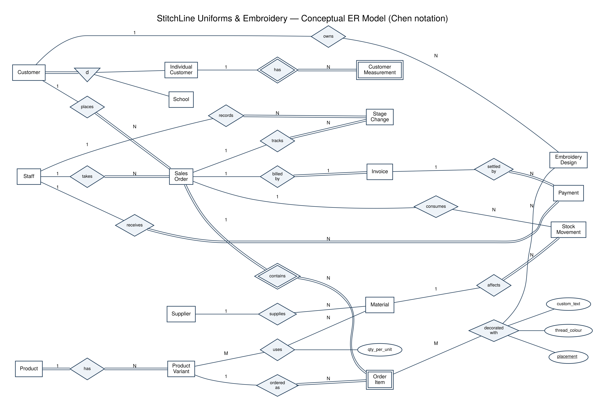

# Portfolio 1 — Database Design and Modelling

**Case study:** StitchLine Uniforms & Embroidery
**DBMS:** PostgreSQL 16

## Folder Contents

| Path | Contents |
|---|---|
| `er-diagram/erd-conceptual.png` | Conceptual ER model (Chen notation) |
| `er-diagram/erd-logical.png` | Logical relational model with keys, types and cardinalities |
| `er-diagram/stitchline.dbml` | Editable source for the logical model ([dbdiagram.io](https://dbdiagram.io)) |
| `er-diagram/stitchline-conceptual.dot` | Editable source for the conceptual model (Graphviz) |
| `sql/schema.sql` | Full DDL: tables, keys, constraints, trigger, view |
| `sql/seed.sql` | Small, hand-written sample dataset |
| `sql/verify.sql` | Consistency checks on the loaded data |
| `sql/constraint-tests.sql` | Statements that must be rejected, one per constraint type |
| `normalisation.md` | Full derivation from UNF to BCNF |
| `test-results/` | Captured output of `verify.sql` and `constraint-tests.sql` |
| `screenshots/` | Screenshots of the schema and test runs |

---

## 1. Case Study Description

**StitchLine Uniforms & Embroidery** produces school uniforms, embroidered badges and sportswear in bulk for schools. It also makes custom Ankara garments for individual customers.

Orders are currently written on paper order sheets. This causes four recurring problems:

- order details (sizes, logo placement, thread colours) get lost or misread;
- invoices are calculated by hand;
- there is no history to refer to when a school reorders the next term;
- nobody knows how much fabric or thread is left until it runs out.

The database replaces the paper sheet and supports an internal order-management application.

### Users

| User | Uses the database to… |
|---|---|
| Owner / admin | Manage staff, products, prices and suppliers; view reports |
| Front-desk staff | Register customers, take orders, attach embroidery designs, record deposits |
| Production staff | Move orders through production stages, record material usage |
| Accounts | Issue invoices, record payments, follow up outstanding balances |

### Major data stored

Customers (schools and individuals), individual body measurements, staff, products and their size/colour variants, raw materials and suppliers, the bill of materials, embroidery designs, orders and order lines, design placements, production stage history, invoices, payments, and a stock-movement ledger.

### Key operations

1. Register a school or individual customer.
2. Take an order with multiple lines, each with one or more embroidery placements.
3. Deduct the required materials from stock, using the bill of materials.
4. Move an order through its stages: received → cutting → sewing → embroidery → ready → delivered.
5. Issue an invoice for the order.
6. Record deposits and part-payments against the invoice.
7. List outstanding balances (the app's "Outstanding" tab).
8. Retrieve a returning customer's order history and stored logos.
9. Restock materials from suppliers and flag materials below their reorder level.

### Scale assumptions

Around 150 schools and 3,000 individual customers. 8,000–10,000 orders a year, with sharp peaks before each school term, at an average of 4 lines per order. 5–10 staff use the system at the same time during peak weeks.

---

## 2. Entity–Relationship Model

### 2.1 Conceptual model (Chen notation)



**Legend:**

| Symbol | Meaning |
|---|---|
| Rectangle | Entity |
| Double rectangle | Weak entity |
| Diamond | Relationship |
| Double diamond | Identifying relationship |
| Ellipse | Relationship attribute (underlined = part of key) |
| Triangle `d` | Disjoint specialisation |
| Double line | Total participation |
| Single line | Partial participation |

### 2.2 Logical model


### 2.3 Entities

| Entity | Type | Description |
|---|---|---|
| Customer | Strong (supertype) | Anyone who places orders |
| School | Subtype | School customer with a contact person |
| Individual Customer | Subtype | Person ordering custom garments |
| Customer Measurement | **Weak** | Body measurement; identified by its owner + measurement name |
| Staff | Strong | Employee using the system |
| Supplier | Strong | Source of raw materials |
| Product | Strong | Catalogue item (e.g. school shirt) |
| Product Variant | Strong | Size/colour version of a product with its current list price |
| Material | Strong | Raw material held in stock (fabric, thread, buttons) |
| Embroidery Design | Strong | Logo or monogram file, usually owned by a customer |
| Sales Order | Strong | One customer order |
| Order Item | **Weak** | One line of an order; identified by order + line number |
| Stage Change | Strong | One move of an order between production stages |
| Invoice | Strong | Bill issued for one order |
| Payment | Strong | One deposit or part-payment |
| Stock Movement | Strong | One addition to or removal from material stock |

### 2.4 Relationships

| Relationship | Entities | Cardinality | Participation |
|---|---|---|---|
| is-a (disjoint, total) | Customer → School / Individual | — | Every customer is exactly one subtype |
| has *(identifying)* | Individual → Measurement | 1 : N | Measurement total |
| places | Customer → Sales Order | 1 : N | Order total; customer partial |
| takes | Staff → Sales Order | 1 : N | Order total |
| owns | Customer → Embroidery Design | 1 : N | Both partial (in-house designs have no owner) |
| contains *(identifying)* | Sales Order → Order Item | 1 : N | Both total |
| has | Product → Product Variant | 1 : N | Both total |
| ordered as | Product Variant → Order Item | 1 : N | Order item total |
| **decorated with** | Order Item ↔ Embroidery Design | **M : N** | Both partial; attributes: placement, custom_text, thread_colour |
| **uses** (bill of materials) | Product Variant ↔ Material | **M : N** | Both partial; attribute: qty_per_unit |
| supplies | Supplier → Material | 1 : N | Both partial |
| billed by | Sales Order → Invoice | **1 : 1** | Invoice total; order partial (draft orders have no invoice yet) |
| settled by | Invoice → Payment | 1 : N | Payment total |
| receives | Staff → Payment | 1 : N | Payment total |
| tracks / records | Sales Order, Staff → Stage Change | 1 : N each | Stage change total |
| affects / consumes | Material, Sales Order → Stock Movement | 1 : N each | Material side total; order side partial |

---

## 3. Relational Schema

PK = <ins>underlined</ins>, FK = *italic*.

| Relation |
|---|
| **customer** (<ins>customer_id</ins>, customer_type, phone, email, address, created_at) |
| **school** (<ins>*customer_id*</ins>, school_name, contact_person, contact_phone) |
| **individual_customer** (<ins>*customer_id*</ins>, first_name, last_name) |
| **customer_measurement** (<ins>*customer_id*, measure_name</ins>, value_cm, recorded_at) |
| **staff** (<ins>staff_id</ins>, full_name, role, email, is_active) |
| **supplier** (<ins>supplier_id</ins>, name, phone) |
| **product** (<ins>product_id</ins>, name, category) |
| **product_variant** (<ins>variant_id</ins>, *product_id*, size, colour, list_price) |
| **material** (<ins>material_id</ins>, *supplier_id*, name, unit, stock_qty, reorder_level) |
| **product_material** (<ins>*variant_id*, *material_id*</ins>, qty_per_unit) |
| **embroidery_design** (<ins>design_id</ins>, *customer_id*, name, file_url, stitch_count) |
| **sales_order** (<ins>order_id</ins>, order_number, *customer_id*, *taken_by*, order_date, due_date, status, notes) |
| **order_item** (<ins>*order_id*, line_no</ins>, *variant_id*, quantity, unit_price) |
| **order_item_design** (<ins>*order_id*, *line_no*, *design_id*, placement</ins>, custom_text, thread_colour) |
| **order_stage_history** (<ins>history_id</ins>, *order_id*, from_stage, to_stage, *changed_by*, changed_at) |
| **invoice** (<ins>invoice_id</ins>, invoice_number, *order_id*, issue_date, due_date, total_amount) |
| **payment** (<ins>payment_id</ins>, *invoice_id*, amount, method, reference, paid_at, *received_by*) |
| **stock_movement** (<ins>movement_id</ins>, *material_id*, *order_id*, *staff_id*, change_qty, reason, moved_at) |

The full DDL is in [`sql/schema.sql`](sql/schema.sql). It creates 18 tables, one trigger and one view.

### Mapping decisions

| ER construct | Mapped as |
|---|---|
| Disjoint, total specialisation | One table per subtype. The subtype PK is also an FK to the supertype. A composite FK on `(customer_id, customer_type)` makes overlap impossible. |
| Weak entities | Composite PK made of the owner's key plus a partial key (`line_no`, `measure_name`) |
| M:N with attributes | Junction tables `order_item_design` and `product_material` |
| 1:1 Order–Invoice | FK `invoice.order_id` with a `UNIQUE` constraint |

---

## 4. Keys

| Table | Primary key | Candidate keys (UNIQUE) | Foreign keys |
|---|---|---|---|
| customer | `customer_id` (surrogate) | `phone`, `(customer_id, customer_type)` | — |
| school | `customer_id` | `school_name` | `(customer_id, customer_type)` → customer |
| individual_customer | `customer_id` | — | `(customer_id, customer_type)` → customer |
| customer_measurement | `(customer_id, measure_name)` | — | `customer_id` → individual_customer |
| staff | `staff_id` | `email` | — |
| supplier | `supplier_id` | `name` | — |
| product | `product_id` | `name` | — |
| product_variant | `variant_id` | `(product_id, size, colour)` | `product_id` → product |
| material | `material_id` | `name` | `supplier_id` → supplier |
| product_material | `(variant_id, material_id)` | — | both → their parents |
| embroidery_design | `design_id` | `(customer_id, name)` | `customer_id` → customer |
| sales_order | `order_id` | `order_number` | `customer_id` → customer, `taken_by` → staff |
| order_item | `(order_id, line_no)` | — | `order_id` → sales_order, `variant_id` → product_variant |
| order_item_design | `(order_id, line_no, design_id, placement)` | — | `(order_id, line_no)` → order_item, `design_id` → embroidery_design |
| order_stage_history | `history_id` | — | `order_id` → sales_order, `changed_by` → staff |
| invoice | `invoice_id` | `invoice_number`, `order_id` | `order_id` → sales_order |
| payment | `payment_id` | — | `invoice_id` → invoice, `received_by` → staff |
| stock_movement | `movement_id` | — | `material_id`, `order_id`, `staff_id` |

### Surrogate or natural keys

Surrogate integer keys are used for every strong entity. The natural identifiers (phone numbers, school names, invoice numbers) can change or be mistyped. If one were the primary key, a correction would have to cascade through every referencing table.

The natural identifiers are still enforced as `UNIQUE` candidate keys, because staff use them to look records up.

Weak entities and junction tables use composite keys. Their identity genuinely depends on their parent: "line 2 of order SL-2026-0001".

---

## 5. Constraints

Each constraint enforces a real business rule. The test script attempts to break each one, and every attempt is rejected. The output is in [`test-results/constraint-tests-output.txt`](test-results/constraint-tests-output.txt).

| # | Constraint | Business rule | Test |
|---|---|---|---|
| 1 | PK `(order_id, line_no)` | An order can't have two "line 1"s | T1 |
| 2 | `UNIQUE (phone)` | One customer record per phone number | T2 |
| 3 | FK `sales_order.customer_id` | An order must belong to a real customer | T3 |
| 4 | `CHECK (quantity > 0)` | You can't order zero items | T4 |
| 5 | `CHECK (stock_qty >= 0)` | You can't use fabric you don't have | T5 |
| 6 | `CHECK (status IN (…))` | Only the defined production stages are allowed | T6 |
| 7 | `chk_order_due_after_order` | The due date can't be before the order date | T7 |
| 8 | FK on `(customer_id, customer_type)` | A school can't also be an individual (disjoint subtypes) | T8 |
| 9 | FK `customer_measurement` → `individual_customer` | Only individuals have body measurements | T9 |
| 10 | `UNIQUE (invoice.order_id)` | One invoice per order | T10 |
| 11 | `chk_usage_has_order` | Material used in production must be traceable to an order | T11 |
| 12 | `ON DELETE RESTRICT` | Customers, orders and invoices with history can't be deleted | T12 |
| 13 | Trigger `prevent_overpayment` | Total payments can't exceed the invoice total | T13 |
| 14 | `ON DELETE CASCADE` (order → order_item → order_item_design) | Deleting a draft order removes its lines | — |
| 15 | `DEFAULT` values | New orders start as `received` and dates default to today | — |

### Why one rule needs a trigger

"Payments must not exceed the invoice total" compares a new row with the *sum of other rows*. A `CHECK` constraint can only see the row being written, so the rule is enforced with a `BEFORE INSERT OR UPDATE` trigger.

The trigger has a known gap. Two payments recorded at the same instant can each read the old balance and both pass. Portfolio 2 replaced this trigger with a stored `amount_paid` column and a single-row `CHECK`, and Portfolio 3 tests it under concurrent payments.

### What the schema does not enforce

**Total** specialisation (every customer *must* have a subtype row) can't be expressed declaratively in PostgreSQL. The application inserts the customer and its subtype in a single transaction. [`sql/verify.sql`](sql/verify.sql) check 2 confirms that every customer has exactly one subtype.

---

## 6. Normalisation

The full derivation is in **[`normalisation.md`](normalisation.md)**. In summary:

| Step | Starting problem | Result |
|---|---|---|
| UNF | The paper order sheet repeats item lines, logos and payments, and copies school details onto every sheet. This causes update, insertion and deletion anomalies. | — |
| 1NF | Repeating groups removed | `ORDER`, `ORDER_LINE`, `LINE_LOGO`, `PAYMENT`, `MEASUREMENT` |
| 2NF | Partial dependencies on composite keys: item category depends only on the item; logo file depends only on the logo | `PRODUCT`, `PRODUCT_VARIANT` and `EMBROIDERY_DESIGN` split out |
| 3NF | Transitive dependencies: order → customer → school details; order → invoice → total; order → staff → role | `CUSTOMER` (with subtypes), `STAFF` and `INVOICE` split out |
| BCNF | Every determinant checked | All determinants are candidate keys |

### Deliberate exceptions

| Attribute | Why it is kept |
|---|---|
| `order_item.unit_price` | It is the price at the time of the order, a historical fact distinct from `list_price` |
| `invoice.total_amount` | An issued invoice is a fixed legal document |
| `material.stock_qty` | Avoids summing the whole ledger on every order, and gives Portfolio 3 a single row to lock. It is verified to reconcile with the ledger. |
| `sales_order.status` | Allows fast filtering by stage; the history table remains the audit trail |

The invoice balance is deliberately **not** stored. It is computed by the view `v_invoice_balance`.

---

## 7. How to Reproduce

```bash
createdb stitchline
psql -d stitchline -f sql/schema.sql
psql -d stitchline -f sql/seed.sql
psql -d stitchline -f sql/verify.sql            # all "matches"/"reconciles" columns = t
psql -d stitchline -f sql/constraint-tests.sql  # T1–T13 each raise an ERROR; T14 succeeds
```

---

## 8. Evidence

| Evidence | Location |
|---|---|
| Tables created (`\dt stitchline.*`) | `screenshots/01-tables-created.png` |
| Table structure with constraints (`\d stitchline.sales_order`) | `screenshots/02-table-structure.png` |
| Verification queries | `test-results/verify-output.txt`, `screenshots/03-verify.png` |
| Constraint tests | `test-results/constraint-tests-output.txt`, `screenshots/04-constraint-tests.png` |
| Outstanding balances view | `screenshots/05-outstanding-view.png` |

---

## 9. Design Decisions and Trade-offs

1. **Material-level stock, not finished-goods stock.** StitchLine makes to order, so what runs out is fabric and thread. Tracking materials through a bill of materials lets one order automatically calculate its fabric requirement.
2. **Stage history as a separate table.** Any staff member can move an order between stages. A single `status` column would lose who made each move and when.
3. **Embroidery designs belong to customers.** A school's crest is reused every term. Storing it once and referencing it from order lines removes the risk of embroidering an outdated logo.
4. **Foreign-key indexes deferred.** PostgreSQL does not index FK columns automatically. They are left unindexed here on purpose, so that Portfolio 2 can measure the effect of adding them.
5. **Measurements as rows.** This is flexible but weakly typed. It is the motivating example for the document model in Portfolio 4.
