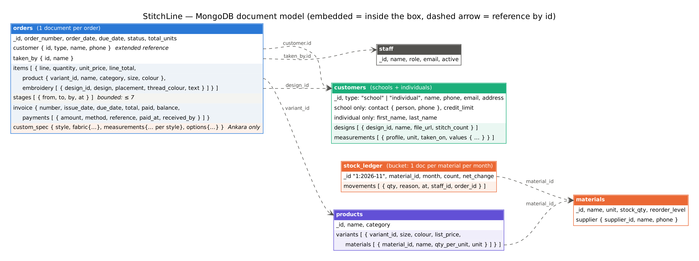
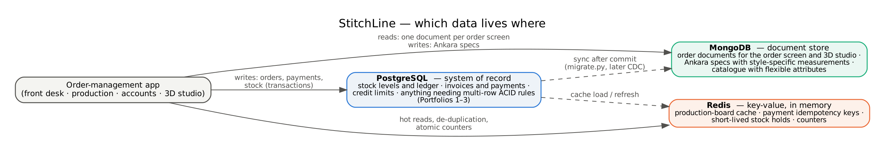

# Portfolio 4 — NoSQL and Advanced Data Models

**Case study:** StitchLine Uniforms & Embroidery
**Models implemented:** **document** (MongoDB) as the main model; **key-value** (Redis) as a second, smaller example
**Built from:** the same PostgreSQL data as Portfolios 1–3 (~100,000 orders)

## Folder Contents

| Path | Contents |
|---|---|
| `models/document-model.png` (+ `.dot`) | Collections, embedded parts and references |
| `models/architecture.png` (+ `.dot`) | Which data lives in PostgreSQL, MongoDB and Redis |
| `mongodb/setup.js` | Creates collections with **schema validators** and **indexes** (mongosh) |
| `mongodb/migrate.py` | Migrates PostgreSQL → MongoDB: 18 tables become 6 collections |
| `mongodb/queries.js` | Queries D1–D12 for mongosh (interactive) |
| `mongodb/run_queries.py` | The same queries in Python, with execution plans; saves output |
| `redis/redis_demo.py` | Key-value examples R1–R4, run against a real Redis server |
| `sample-data/*.json` | Real documents produced by the migration |
| `test-results/` | Query and demo output |

---

## 1. Why Look Beyond the Relational Model?

Portfolios 1–3 built a solid relational database, but three parts of StitchLine sit awkwardly in it:

1. **Ankara custom orders.** Portfolio 1 stored body measurements as name/value rows and flagged this as a known limitation. Each garment style needs a *different* set of measurements and options: an agbada needs agbada length and trouser length; a gown needs bust, hip and gown length; and every style has its own options. A relational design either needs a table per style, or loses all type checking with name/value rows.
2. **The order screen.** Showing one order in the app takes a **7-table join** (Portfolio 1, `verify.sql` #6): order, customer, school/individual, lines, variants, products, designs. The app always loads an order as a whole.
3. **The production board.** It is read constantly, changes often, and doesn't need to be durable: it can always be rebuilt from PostgreSQL.

---

## 2. Choosing the Model

| NoSQL model | What it is good at | Fit for StitchLine | Verdict |
|---|---|---|---|
| **Document** (MongoDB) | Self-contained records with nested and varying structure, read as a whole | Orders really are documents: header, lines, embroidery, history and invoice belong together. Ankara specs vary by style. | ✅ **Main model** |
| **Key-value** (Redis) | Very fast reads and writes by key, expiry (TTL), atomic counters | Production board, de-duplicating payment submissions, short-lived stock holds | ✅ **Second model**, small |
| Wide-column (Cassandra) | Huge write volume spread over many nodes, time-series | The stock ledger *is* a time series, but at ~20,000 movements a year in total it is far below the scale that justifies Cassandra | ❌ Discussed, not used |
| Graph (Neo4j) | Many-hop relationships such as recommendations or networks | StitchLine's relationships are one or two hops (customer → order → design). SQL joins already handle them. | ❌ Discussed, not used |

---

## 3. The Document Model



**18 relational tables become 6 collections.**

| Collection | Built from (relational tables) | Docs | Example |
|---|---|---|---|
| `orders` | sales_order, order_item, order_item_design, order_stage_history, invoice, payment (+ snapshots of customer, product, staff) | 100,006 | [order-school.json](sample-data/order-school.json) |
| `customers` | customer, school, individual_customer, customer_measurement, embroidery_design | 3,150 | [customer-school.json](sample-data/customer-school.json), [customer-individual.json](sample-data/customer-individual.json) |
| `products` | product, product_variant, product_material | 13 | [product-blazer.json](sample-data/product-blazer.json) |
| `materials` | material, supplier | 9 | [material.json](sample-data/material.json) |
| `stock_ledger` | stock_movement, bucketed by material and month | 1,050 | [stock-ledger-bucket.json](sample-data/stock-ledger-bucket.json) |
| `staff` | staff | 15 | — |

### 3.1 Embed or reference? Each decision explained

The rule of thumb: **embed what is read together and owned by the parent; reference what is shared, large or unbounded.**

| Relationship | Decision | Why |
|---|---|---|
| Order → lines → embroidery | **Embed** | Always read and written with the order; owned by it; bounded (≤ 6 lines) |
| Order → stage history | **Embed** | Read with the order; bounded (≤ 7 stages, the fixed workflow) |
| Order → invoice → payments | **Embed** | 1:1 invoice; ≤ 2–3 payments per invoice in practice. This makes payment atomic (D9). |
| Order → customer | **Reference + snapshot** (*extended reference* pattern) | A customer has thousands of orders, so the customer can't be embedded. The order keeps `{id, name, phone}` for display, and the full record is one lookup away. |
| Order line → product | **Reference + snapshot** | The snapshot records what was sold *at that time*, the same principle as `unit_price` in Portfolio 1 |
| Customer → designs | **Embed** | A school's crest belongs to it and is reused every term |
| Customer → measurements | **Embed**, as profiles | Small; only meaningful for that person |
| Product → variants → bill of materials | **Embed** | 13 products, ≤ 24 variants each. The catalogue is read as a whole. |
| Material → stock movements | **Reference**, via buckets | ~2,000 movements a year per material, growing for ever, is unbounded, so it can't go inside the material document |

### 3.2 Design patterns used

| Pattern | Where | Purpose |
|---|---|---|
| **Polymorphic** | `customers` holds schools and individuals | Replaces the supertype/subtype tables. A `type` field plus validator `oneOf` keeps the specialisation disjoint. |
| **Extended reference** | `orders.customer`, `orders.items.product`, `orders.taken_by` | Shows the order screen without a second query |
| **Computed** | `invoice.balance`, `total_units`, `line_total` | Stored at write time so they can be indexed (the same idea as Portfolio 2's `amount_paid`) |
| **Bucket** | `stock_ledger`: one document per material per month | Keeps arrays bounded (largest bucket 116 KB, far below the 16 MB document limit). Monthly totals are pre-computed. |
| **Flexible sub-document** | `orders.custom_spec` | Different shape per Ankara style, each one still validated |

### 3.3 Schema-flexible, not schema-less

[`setup.js`](mongodb/setup.js) attaches a `$jsonSchema` validator to each collection. The `orders` validator enforces:

- the required fields, the status values, at least one line, and `quantity ≥ 1`;
- money stored as `decimal` (`Decimal128`, never a float);
- the **embroidery placement** list from Portfolio 1's `CHECK`;
- **one measurement shape per Ankara style**:

  ```js
  custom_spec: { oneOf: [
    { properties: { style: { enum: ["agbada"] },
                    measurements: { required: ["chest","shoulder","sleeve","agbada_length","trouser_length","waist"] } } },
    { properties: { style: { enum: ["gown"] },
                    measurements: { required: ["bust","waist","hip","gown_length"] } } },
    … ] }
  ```

- **Portfolio 2's overpayment rule**, using `$expr`: `invoice.paid ≤ invoice.total` and `balance = total − paid`. That is the document equivalent of `CHECK (amount_paid <= total_amount)`.

So the document model *gains* checking for Ankara specs that the relational name/value design couldn't do, while keeping the rules the earlier portfolios relied on.

### 3.4 Indexes

| Index | Query served |
|---|---|
| `{order_number: 1}` unique | look up an order by its number |
| `{"customer.id": 1, order_date: -1}` | D1 customer history |
| `{due_date: 1}` **partial**, `status ∈ open stages` | D4 production board, D6 stuck orders |
| `{"invoice.due_date": 1}` **partial**, `invoice.balance > 0` | D3 overdue balances |
| `{order_date: 1}` | D5 revenue report |
| `{phone: 1}` unique, `{type: 1, name: 1}` on customers | customer lookup |
| `{material_id: 1, month: -1}` on stock_ledger | D11 recent ledger |

These are the same access paths Portfolio 2 found. The two partial indexes carry over directly, because MongoDB supports `partialFilterExpression`.

---

## 4. Implementation

### 4.1 Running it

The results below come from **MongoDB 7.0 running in Docker as a single-node replica set**. Multi-document transactions (D13) need a replica set. MongoDB Atlas's free tier (M0) also runs as a replica set, so it works the same way, and it is the starting point for Portfolio 5.

```bash
# 1. MongoDB 7.0 as a single-node replica set
docker run -d --name stitchline-mongo -p 27018:27017 mongo:7.0 --replSet rs0 --bind_ip_all
docker exec stitchline-mongo mongosh --quiet --eval 'rs.initiate({_id: "rs0", members: [{_id: 0, host: "localhost:27017"}]})'
export MONGODB_URI="mongodb://127.0.0.1:27018/?directConnection=true"
#    or, on Atlas: export MONGODB_URI="mongodb+srv://<user>:<password>@<cluster>.mongodb.net/"
pip install pymongo "psycopg[binary]"

# 2. Collections, validators, indexes
mongosh "$MONGODB_URI" --file mongodb/setup.js

# 3. Migrate from PostgreSQL (PG* variables point at the stitchline database)
python3 mongodb/migrate.py                 # ~100,000 orders (~164 MB of BSON before compression)
#   python3 mongodb/migrate.py --since 2022  # smaller, if storage is tight

# 4. Queries with execution plans, saved to test-results/mongodb-queries.txt
python3 mongodb/run_queries.py

# 5. Interactive version for screenshots
mongosh "$MONGODB_URI" --file mongodb/queries.js
```

Host port 27018 avoids a clash with a MongoDB installed locally on the default port 27017. On Windows, use `python` instead of `python3`.

### 4.2 Verification

Run on MongoDB 7.0.48 (Docker, replica set `rs0`) with the Portfolio 1–3 PostgreSQL database as the source. Full output: [`test-results/mongodb-queries.txt`](test-results/mongodb-queries.txt).

| Check | Result |
|---|---|
| `setup.js` | 6 collections; `$jsonSchema` validators on `orders`, `customers`, `products` and `materials`; 9 secondary indexes |
| `migrate.py` | All 100,006 orders and the other 5 collections migrated in 27.6 s, with money stored as `Decimal128` |
| Index use (`explain`) | D1 reads 109 documents through `IXSCAN(customer.id_1_order_date_-1)`, against 100,006 with a forced collection scan. The partial indexes read exactly 50 (D3) and 585 (D4) documents. |
| Validator (D8) | The incomplete gown specification is **rejected** (`Document failed validation`, code 121) |
| Transaction (D13) | The forced failure aborts the transaction: no order is saved and the poplin stock is unchanged |
| Cross-check against PostgreSQL | D5 matches the Portfolio 2 summary view to the cent on all 60 month/category rows. D4 = 585 open orders and D6 = 339 stuck orders match Q3 and Q5. D7 = 223 matches a direct SQL count. |
| `queries.js` | Runs in mongosh without errors |

---

## 5. Queries

| # | Query | MongoDB technique | Relational equivalent |
|---|---|---|---|
| D1 | Customer history | `find` + compound index; explain shows index scan vs forced collection scan | Q1, a 3-table join |
| D2 | Full order screen | **one `findOne`** | 7-table join |
| D3 | Overdue balances | partial index on unpaid invoices | Q2/Q2b |
| D4 | Production board | partial index on open orders | Q3 |
| D5 | Monthly revenue by category | aggregation: `$match → $unwind → $group → $project` | Q4 |
| D6 | Stuck orders | `$arrayElemAt: ["$stages.at", -1]`. The latest stage is inside the document, so no subquery is needed. | Q5 (correlated subquery: 12 s before indexing) |
| D7 | Waist 70–75 cm | `$elemMatch` inside embedded measurement profiles | name/value row filter |
| D8 | Agbada and gown orders with different spec shapes; an incomplete gown spec is **rejected** | flexible schema + `oneOf` validator | not possible without a table per style |
| D9 | Two payments of 50 on a balance of 60 | **conditional atomic update** (`$expr` + `$inc` + `$push`) | Portfolio 3 s14 |
| D10 | Two staff move the same order | optimistic update (`status: "cutting"` in the filter) | Portfolio 3 s18 |
| D11 | Recent stock ledger | bucket documents | stock_movement range scan |
| D12 | Document sizes | `$bsonSize` | — |
| D13 | New order + stock deduction, then a forced failure | **multi-document transaction** (`with_transaction`) rolls back both | Portfolio 3 atomicity |

Selected results ([full output](test-results/mongodb-queries.txt)):

```
=== D9 Atomic conditional payment on SL-2026-0004
  before: {"invoice": {"total": {"$numberDecimal": "120.00"}, "paid": {"$numberDecimal": "60.00"}, "balance": {"$numberDecimal": "60.00"}}}
  pay 50 (Daniel): modified=1
  pay 50 (Mei)   : modified=0   ← refused: would exceed the total
  after : {"invoice": {"total": {"$numberDecimal": "120.00"}, "paid": {"$numberDecimal": "110.00"}, "balance": {"$numberDecimal": "10.00"}}}

=== D10 Optimistic stage move on SL-2026-0005 (status 'cutting')
  Aisha: cutting → sewing    modified=1
  Liam : cutting → cancelled modified=0   ← refused: no longer at 'cutting'
```

D9 needs neither a transaction nor a lock held by the application. A single-document update in MongoDB is **atomic**: the condition (`paid + 50 ≤ total`) and the change are applied as one step. In Portfolio 3 this needed a row lock and a `CHECK`. Here it falls out naturally because the invoice and its payments live in one document.

---

## 6. Consistency Trade-offs

| Topic | Document model behaviour | Consequence for StitchLine |
|---|---|---|
| **Atomicity** | A single-document write is always atomic. Writes across several documents need a transaction (D13, replica set only). | Payments and stage moves are single-document and safe. *Order + stock deduction* spans two collections, so it needs a transaction, or it stays in PostgreSQL. |
| **Snapshots go stale** | `customer.name` inside 100,000 orders is not updated when a school renames | Acceptable, and often correct: it records the name at the time of the order, as an invoice does. Current details come from `customers`. |
| **Duplication cost** | Field names are repeated in every document; snapshots repeat data | Orders take **164 MB of BSON** against **90 MB** for the equivalent relational tables (166 MB with indexes). On disk, MongoDB's compression brings the orders down to 23 MB, plus 11 MB of indexes. |
| **No foreign keys** | Nothing stops `customer.id: 99999` being written | Integrity rests on the application and validators. This is a real loss compared with Portfolio 1. |
| **Ad-hoc analysis** | Reports that cut across documents need aggregation pipelines | D5 works, but SQL (plus the Portfolio 2 summary view) is simpler for reporting |

---

## 7. Key-Value Model (Redis)

[`redis/redis_demo.py`](redis/redis_demo.py) was run against a **Redis 7.4 server**. Output: [`test-results/redis-demo-output.txt`](test-results/redis-demo-output.txt).

```bash
# any Redis 6+: a local install, `docker run -p 6379:6379 redis:7`, or a free Redis Cloud database
export REDIS_URL="redis://localhost:6379/0"
pip install redis "psycopg[binary]"
python3 redis/redis_demo.py        # reads open orders from PostgreSQL (PG* variables)
```

| # | Use | Redis structures | Result |
|---|---|---|---|
| R1 | **Production board cache** | a hash per order (`sl:order:<number>`), a sorted set by due date (`sl:board:due`), and a hash of stage counts | 585 open orders loaded in 32 ms; 1.6 MB of memory, 152 bytes per order |
| R2 | **Optimistic stage move** | `WATCH` / `MULTI` / `EXEC` | B moved the order first, so A's `EXEC` raised **WatchError** and nothing was applied |
| R3 | **Payment de-duplication** | `SET key NX EX 600` | 3 clicks led to **1 payment** recorded; the key expires after 10 minutes |
| R4 | **Stock reservation**: 50 threads reserve 1 cone from 30 | naive `GET`/`SET` vs a **Lua script** | naive: **50 accepted, oversold by 20**. Lua: **exactly 30 accepted, stock 0**. |

**R4 reproduces Portfolio 3's lost update (s06) in Redis.** Redis runs one command at a time, but a read in one command followed by a write in another is still not atomic. A Lua script runs as one indivisible unit, which fixes it, just as the atomic `UPDATE` did in PostgreSQL.

### An honest note on speed

```
top-10 board    Redis  1.676 ms   PostgreSQL (indexed, Portfolio 2)  0.766 ms
stage counts    Redis  0.617 ms   PostgreSQL GROUP BY                0.837 ms
```

Redis was **not** faster for the board. After Portfolio 2's partial index, PostgreSQL answers in one round trip. The Redis version needs two (`ZRANGE`, then a pipelined `HGETALL`), and at StitchLine's scale (585 open orders) the network round trip dominates. For the stage counts Redis was slightly quicker (0.62 against 0.84 ms), a difference of a fraction of a millisecond.

So the case for Redis here is not speed. It is **features PostgreSQL lacks or makes awkward**: automatic expiry (R3), very cheap atomic counters, and memory-only state that can be thrown away and rebuilt. At a much larger scale, or with hundreds of screens polling the board every few seconds, the speed argument would return.

---

## 8. Suitability: What Goes Where



| Data | Best home | Reason |
|---|---|---|
| Stock levels and ledger, invoices and payments, credit limits | **PostgreSQL** | Rules span many rows and tables (stock across orders, credit across invoices). They need foreign keys, multi-row transactions and the concurrency controls proved in Portfolio 3. |
| Order documents for the app's order screen and 3D studio | **MongoDB** | Read as a whole; nested; the 3D studio's placement data maps naturally to `items[].embroidery[]` |
| Ankara custom specifications | **MongoDB** (their only home) | Different shape per style, validated per style. The relational model could not express this. |
| Product catalogue | **MongoDB**, or either | Variants and bill of materials embed neatly; new product types can carry new attributes |
| Production board, idempotency keys, short stock holds | **Redis** | Ephemeral, rebuildable, benefits from TTL and atomic counters |
| Management reports | **PostgreSQL** | SQL plus a materialised view is simpler and faster to write than aggregation pipelines |

**Conclusion.** For StitchLine, NoSQL is a *complement*, not a replacement. Moving the financial and stock data out of PostgreSQL would give up foreign keys, cross-table constraints and the concurrency guarantees tested in Portfolio 3, all for a workload that is small.

The document model earns its place where the data is document-shaped (orders as the app sees them) and where the relational model was genuinely weak (style-specific Ankara measurements). Redis earns a small place for short-lived, fast-changing state.

**The cost of this architecture is synchronisation.** Two databases must agree. `migrate.py` is a batch load. A production system would stream changes from PostgreSQL (change data capture) and accept that MongoDB lags by moments: **eventual consistency**. Portfolio 5 picks this up.

---

## 9. Screenshots

| Screenshot | File |
|---|---|
| Collections with document counts, indexes and validators | `screenshots/01-collections.png` |
| `setup.js` output (collections, indexes) | `screenshots/02-setup.png` |
| `migrate.py` document counts | `screenshots/03-migration.png` |
| One order document in mongosh | `screenshots/04-order-document.png` |
| D1 explain: index scan vs collection scan | `screenshots/05-explain.png` |
| D8 invalid Ankara spec rejected by the validator | `screenshots/06-validator.png` |
| D9 / D10 atomic and optimistic updates | `screenshots/07-atomic-updates.png` |
| D13 transaction rolled back | `screenshots/08-transaction.png` |
| Redis demo R1–R4 | `screenshots/09-redis.png` |
