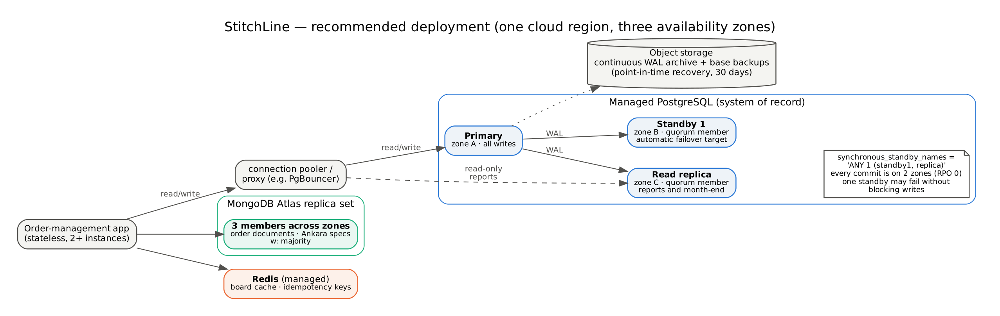

# Portfolio 5 — Distributed and Cloud Database Exercise

**Case study:** StitchLine Uniforms & Embroidery
**What was built:** a working 5-server PostgreSQL deployment (1 primary, 2 streaming replicas, 2 shards) holding the full StitchLine database, and a recommended architecture for running it in the cloud.

## Folder Contents

| Path | Contents |
|---|---|
| `scripts/cluster.sh` | Builds, starts, stops and resets the 5-server cluster from the StitchLine database |
| `scripts/replication_demo.py` | R1–R7: replication, consistency, synchronous commit, failover |
| `scripts/partitioning.sql` | Range partitioning by year: pruning and archiving |
| `scripts/sharding_demo.py` | S1–S6: hash sharding with `postgres_fdw`, two-phase commit |
| `config/architecture.png` (+ `.dot`) | Recommended production deployment |
| `test-results/` | Output of every script |
| `screenshots/` | Screenshots |

```bash
cd scripts
./cluster.sh up                 # ~5–10 min: copies the stitchline DB, makes base backups
psql -h /tmp/stitchline-cluster/sock -p 5440 -d stitchline -e -f partitioning.sql
python3 sharding_demo.py        # S1–S6
python3 replication_demo.py     # R1–R7, run LAST: R7 leaves replica1 (5441) as the new primary
./cluster.sh reset              # delete everything
```

Linux, macOS or WSL is needed for `cluster.sh`. On Windows the cluster was run inside a Linux container, copying the database from the Portfolio 2 PostgreSQL container on port 5433:

```bash
docker run -d --name stitchline-p5 -v "$PWD:/work" --entrypoint sleep postgres:16-alpine infinity
docker exec stitchline-p5 apk add --no-cache python3 py3-psycopg
docker exec -u postgres -w /work/scripts     -e PGHOST=host.docker.internal -e PGPORT=5433 -e PGUSER=postgres -e PGPASSWORD=bench     stitchline-p5 ./cluster.sh up
```

All five servers run on one machine. That is enough to show real replication, failover and sharding behaviour, but it says little about network latency between real data centres (see §7.4).

---

## 1. The Cluster

```
                          ┌──────────────► replica1  :5441  hot standby (read-only)
  application ──► primary :5440  ── WAL ──┤
     (writes)     stitchline DB           └──────────────► replica2  :5442  hot standby (read-only)

  coordinator (primary) ── postgres_fdw ──► shard1 :5450   orders with hash(customer_id) % 4 ∈ {0, 2}
                                       └──► shard2 :5451   orders with hash(customer_id) % 4 ∈ {1, 3}
```

[`cluster.sh`](scripts/cluster.sh) does the following:
- dumps the StitchLine database, creates the primary with `wal_level = replica`, `wal_log_hints = on` and data checksums, and restores the dump;
- creates a **replication slot** per replica, so the primary keeps the WAL until each replica has received it;
- clones each replica with `pg_basebackup -R -S <slot>`. That writes `standby.signal` and `primary_conninfo`, so the replica starts streaming immediately;
- creates two empty, independent shard servers.

Output: [`test-results/cluster-up-output.txt`](test-results/cluster-up-output.txt)

```
  primary   port 5440  running  primary/standalone
  replica1  port 5441  running  standby
  replica2  port 5442  running  standby
  shard1    port 5450  running  primary/standalone
  shard2    port 5451  running  primary/standalone
  replication (from primary, the current primary):
    replica1  state=streaming  sync=async
    replica2  state=streaming  sync=async
```

---

## 2. Replication

Full output: [`test-results/replication-demo-output.txt`](test-results/replication-demo-output.txt)

**How it works.** PostgreSQL writes every change to its write-ahead log (WAL) before changing the data files. *Streaming replication* sends that WAL to each replica, which replays it, giving an exact physical copy of the primary. By default the primary confirms a commit to the application as soon as the WAL is on *its own* disk. It does not wait for the replicas, which makes the replication **asynchronous**.

| # | Test | Result |
|---|---|---|
| R1 | Status | Both replicas `streaming`, 0 bytes behind, slots `active`. **100,006 orders on all three servers.** |
| R2 | Commit 20 orders on the primary, then poll each replica until the order appears | replica1: median **1.82 ms** (max 4.36 ms); replica2: median **1.46 ms** (max 3.46 ms) |
| R3 | Write on a replica | `ERROR [25006] cannot execute INSERT in a read-only transaction`. `place_order()` fails the same way, at its `SELECT … FOR UPDATE`. |
| R4 | Run the annual revenue report on replica1 | Same result as on the primary (`identical: True`). Heavy reports can run on a replica without competing with order entry. |

---

## 3. Consistency

### 3.1 Asynchronous replication can return stale data (R5)

To make the replication lag visible, replica1's replay was paused (`pg_wal_replay_pause()`). The front desk then recorded a 25.00 payment on INV-2026-0004:

```
  server    amount_paid seen
  primary   85.00
  replica1  60.00      ← 51,736 bytes of WAL behind: the OLD balance
  replica2  85.00
  replay resumed → replica1 shows 85.00 almost at once  (eventual consistency)
```

If the app read balances from replica1, a customer who has just paid would be told they still owe the money. This is **eventual consistency**: replicas converge on the right value, but at any moment one can be behind. The guarantee called *read-your-writes* (you always see your own changes) is not provided.

### 3.2 Synchronous replication buys read-your-writes (R6)

50 times: insert a row on the primary, then **immediately** read it from replica1.

| Mode | Median commit | Row already visible on replica1 |
|---|---|---|
| asynchronous | 1.31 ms | **1 / 50** |
| `synchronous_standby_names = 'FIRST 1 (replica1)'`, `synchronous_commit = on` | 2.52 ms | 50 / 50 |
| same, `synchronous_commit = remote_apply` | 2.57 ms | **50 / 50** |

- **asynchronous** commits as soon as the primary's own disk has the WAL. The replica caught up before the immediate read only once in 50 tries, so an application cannot rely on it.
- **`on`** waits until replica1 has the WAL **on disk**. That guarantees no data loss if the primary dies, but not that the replica has *applied* the change yet. Here it had applied it every time (50/50), but nothing promises that.
- **`remote_apply`** waits until the change is **visible to queries** on replica1: full read-your-writes.

The cost here is about 1.2 ms per commit, because the servers share one machine. Between availability zones it is typically 1–3 ms per commit; between regions, tens of milliseconds.

---

## 4. Availability and Failover

### 4.1 Synchronous replication can stop all writes (R6)

With `FIRST 1 (replica1)`, replica1 was crashed:

```
  FIRST 1 (replica1): a new commit on the primary is still waiting after 3 s → BLOCKED (writes unavailable)
  pg_stat_activity shows the session waiting on: SyncRep
  switched to quorum ANY 1 (replica1, replica2) → the waiting commit committed after 10.0 s in total
     (released at replica2's next status report; an idle replica reports every wal_receiver_status_interval = 10 s)
  next commit with replica1 still down: 3.56 ms ✓
  replica1 restarted and caught up from its slot: state=streaming sync=quorum
```

This is the **CAP trade-off** in action. With one named synchronous replica, losing that replica (or the network link to it) means the primary *refuses to confirm writes*: it chooses consistency over availability.

**Quorum commit** (`ANY 1 (replica1, replica2)`) keeps the guarantee that every commit exists on at least two servers, while tolerating the loss of either replica. When replica1 came back, its replication slot meant the primary had kept every WAL record it missed, and it caught up automatically.

### 4.2 Primary crash and failover (R7)

```
  t=0.00s  primary killed (pg_ctl stop -m immediate = simulated crash)
  t=0.10s  application cannot connect to port 5440: writes are DOWN
  t=0.22s  replica1 promoted (pg_ctl promote) → now accepts writes
  t=0.25s  first order written on the new primary  → downtime ≈ 0.3 s
  new primary is on timeline 2; marker row survived
  orders before crash 100,006 → on new primary 100,007 (+1 new): no committed data lost
  replica2 re-pointed to port 5441: streaming, sees the new order: True
  pg_rewind on the old primary: ok
  new topology — pg_stat_replication on replica1 (the new primary):
    old_primary  streaming  async
    replica2     streaming  async
```

The four steps of a failover:

1. **Detect** that the primary is gone. Here this was instant, because the script knew it had killed it. In production, a tool such as Patroni or a managed service's health checks decides after several missed heartbeats, typically **10–30 seconds**, to avoid failing over on a brief glitch.
2. **Promote** the most up-to-date replica. It switches to a new **timeline** (2), so its WAL history can never be confused with the old primary's.
3. **Re-point** the other replicas. replica2 was redirected by changing `primary_conninfo` and reloading, with no restart and no new base backup.
4. **Rejoin** the old primary. `pg_rewind` rolls back the WAL it wrote that never reached the new primary, which avoids copying the whole database again. This needs `wal_log_hints` or data checksums, both set in `cluster.sh`. It also needs the old primary's WAL from before the point where the timelines forked. `pg_rewind` first finishes crash recovery on the old primary, and the checkpoint at the end of that recovery deletes old WAL segments unless some are kept, so `cluster.sh` sets `wal_keep_size = 256MB`. The old primary then starts as a replica.

The application also has to find the new primary. That is the job of a connection proxy, a DNS name that moves, or a multi-host connection string (`host=a,b target_session_attrs=read-write`).

**Data loss.** With asynchronous replication, any commit not yet streamed when the primary dies is lost. The **recovery point objective (RPO)** equals the replication lag, a few milliseconds here (R2). Synchronous `on` or `remote_apply` makes the RPO **zero**, at the cost shown in §4.1.

---

## 5. Partitioning and Sharding

### 5.1 Range partitioning on one server

Output: [`test-results/partitioning-output.txt`](test-results/partitioning-output.txt). `sales_order` was copied into a table partitioned by `order_date`, one partition per year.

| Test | Result |
|---|---|
| Distribution | 11 partitions of ~9,000–9,300 orders (2026: 8,407 so far) |
| 2025 report | `Seq Scan on sales_order_part_2025` only: **partition pruning**. The other 10 years are never touched. |
| Customer history (`customer_id = 94`) | **All 13 partitions searched** (the 11 years with data, plus the empty 2027 and default partitions), because the query doesn't filter on the partition key |
| Archive 2016 | `DELETE` of 9,124 rows: 4.5 ms, plus a WAL record per row and dead rows to vacuum. `DETACH PARTITION`: 1.6 ms, metadata only. The `DELETE` grows with the size of the year; the `DETACH` does not. |

**Lesson:** the partition key decides which queries get faster and which get slower. Year-based partitioning suits reporting and archiving, and slightly penalises per-customer lookups.

### 5.2 Hash sharding across two servers

Output: [`test-results/sharding-demo-output.txt`](test-results/sharding-demo-output.txt)

**Design:**
- **Shard key: `customer_id`.** Almost every operational query is "this customer's orders" (the order screen, history, credit check), and hashing on the customer keeps all of one customer's orders on one shard.
- **4 hash partitions over 2 servers.** Adding a third server later means moving whole partitions, not re-hashing every row.
- **The coordinator** (the primary) holds a partitioned table whose partitions are **foreign tables** on the shards (`postgres_fdw`). The application still sees one table called `orders_sharded`.

| # | Test | Result |
|---|---|---|
| S1 | Load 100,006 orders through the coordinator | 1.6 s, each row routed to its shard by `hash(customer_id)` |
| S2 | Distribution | shard1 **52,696**, shard2 **47,310** (53 / 47). The largest customer, Greenfield Academy, has **4,744 orders (4.7 %)**, all on one partition: a **hot spot** that hashing can't split |
| S3 | Customer history (`customer_id = 94`) | **One** foreign scan: `Remote SQL: … FROM shard.orders_p2 WHERE customer_id = 94`. 109 rows in 3.4 ms; the other shard is never contacted. |
| S4 | Order count and revenue by **status** | Every partition is read in full and its rows shipped to the coordinator, which aggregates each one and merges the results (scatter-gather). 170 ms against 78 ms on one server: at this size, coordination costs more than it saves. PostgreSQL 16's `postgres_fdw` cannot push partial aggregates to a shard, so the shards ship rows. |
| S4b | Group **by customer** (the shard key) | The whole aggregate runs on the shards: `Remote SQL: SELECT customer_id, count(*), sum(total_amount) … GROUP BY 1`. One row per customer crosses the network. |
| S5 | Find by `order_number` (not the shard key) | All 4 partitions are asked (`Async Foreign Scan` ×4). Uniqueness of `order_number` across shards **cannot be enforced**, because each shard only sees its own rows. |
| S6 | Move an order between shards | Two-phase commit, below |

### 5.3 Distributed transactions: two-phase commit (S6)

Moving an order from shard1 to shard2 is a delete on one server and an insert on another. Both must happen, or neither.

```
  phase 1: both shards PREPARED (each has promised it can commit)
  -- coordinator crashes here, before sending COMMIT PREPARED --
  shard1: pg_prepared_xacts → ['move_order_1_shard1'] (survived the session ending)
  shard2: pg_prepared_xacts → ['move_order_1_shard2'] (survived the session ending)
  shard1: another session tries to touch order 1 → ERROR canceling statement due to lock timeout
  phase 2: COMMIT PREPARED on both → order 1 on shard1: 0, on shard2: 1  (moved exactly once)
```

- **Phase 1** (`PREPARE TRANSACTION`): each shard does the work, saves it durably and votes "yes", without making it visible yet.
- **Phase 2** (`COMMIT PREPARED`): once all have voted yes, the coordinator tells them to commit.

The demo shows the protocol's known weakness. If the coordinator disappears between the phases, the prepared transactions **keep their locks** until someone resolves them, so other work on those rows is blocked. 2PC guarantees atomicity at the cost of availability.

`postgres_fdw` does **not** use 2PC by itself. A crash between its two remote commits could leave one shard committed and the other not, so cross-shard writes need either 2PC (with a recovery process) or a design that avoids them.

---

## 6. Deployment and Cloud Architecture

### 6.1 What was deployed

| Component | Where | Evidence |
|---|---|---|
| PostgreSQL primary + 2 replicas + 2 shards | Local cluster (`cluster.sh`) in a Linux container, the same software as a cloud VM | `test-results/cluster-up-output.txt`, `replication-demo-output.txt`, `partitioning-output.txt`, `sharding-demo-output.txt` |

### 6.2 Recommended production architecture



| Decision | Choice | Reason |
|---|---|---|
| PostgreSQL | A **managed** service with high availability across zones, for example AWS RDS/Aurora, Azure Database for PostgreSQL, Google Cloud SQL, or Neon | Failover, backups, patching and monitoring (§4.2 by hand) are done for you |
| Replication | Primary + 2 replicas in **3 availability zones**, `synchronous_standby_names = 'ANY 1 (standby1, replica)'` | Every commit is on two zones (**RPO = 0** for payments and stock), and either replica can fail without blocking writes (§4.1) |
| Reads | Reports and month-end on the replica; **the order screen and credit checks on the primary** | Avoids the stale balance in §3.1 where it matters |
| Backups | Continuous WAL archiving + nightly base backups to object storage, 30-day point-in-time recovery | Replication protects against server loss, **not** against a bad `DELETE`, which replicates too. Point-in-time recovery does protect against that. |
| Region | A single region close to StitchLine's staff; a cross-region read replica only if disaster recovery requirements justify it | Synchronous commit across regions would add tens of ms to every order |
| MongoDB | Atlas, 3 members, `w: "majority"` | Acknowledged writes survive the loss of any one member |
| Sharding | **Not used** | See §7.3 |

---

## 7. Discussion: What StitchLine Actually Needs

### 7.1 CAP and PACELC by type of data

The **CAP theorem**: when the network splits (Partition), a distributed system must choose between Consistency and Availability.

**PACELC** adds that **E**lse, in normal operation, it trades **L**atency against **C**onsistency.

| Data | During a failure (P → A or C) | Normally (E → L or C) | Configuration |
|---|---|---|---|
| Payments, invoices, stock | **C**: refuse writes rather than lose or duplicate money or fabric | **C**: a millisecond of synchronous commit is cheap | quorum `remote_apply` / `on`; read from the primary |
| Orders being entered | **C** | **C** | as above (same transaction as stock) |
| Order documents (MongoDB) | **C** for writes (`w: majority`) | **L** for read-only screens; secondaries acceptable | causal sessions where a user reads their own change |
| Production board (Redis) | **A**: a slightly old board is better than no board | **L** | rebuilt from PostgreSQL if lost |
| Management reports | **A** | **L**: minutes-old data is fine | async replica |

### 7.2 Consistency levels seen in this portfolio

| Level | Where it was observed |
|---|---|
| Strong (always the latest committed value) | the primary; synchronous `remote_apply` replica (R6: 50/50) |
| Read-your-writes | synchronous `remote_apply` replica (R6) |
| Eventual | async replica during lag (R5: 60.00 vs 85.00); MongoDB copy fed by `migrate.py` (Portfolio 4) |

### 7.3 Should StitchLine shard? No, not now

| Factor | StitchLine today | Sharding threshold |
|---|---|---|
| Data size | a few hundred MB for 11 years | hundreds of GB to TB, beyond one server's disk or memory |
| Write rate | ~25 orders a day on average, ~80 at peak | thousands of writes a second |
| Read load | Covered by Portfolio 2 indexes plus replicas | beyond what replicas can absorb |

**What sharding cost, from this portfolio's own tests:**
- no global unique constraints (S5);
- aggregate queries slower than one server at this size (S4: 170 vs 78 ms);
- cross-shard writes need two-phase commit, with its blocking failure mode (S6);
- one customer can become a hot spot (S2: 4.7 % of orders on one partition);
- rebalancing when servers are added.

**What it would buy:** nothing StitchLine needs. A single primary with two replicas handles more than 1,000 times today's load.

**When it would be worth it.** If StitchLine became a multi-tenant platform serving many uniform companies, sharding by **tenant** would be natural: every query is scoped to one company, and companies are independent, so cross-shard transactions would almost never happen.

Range **partitioning** by year (§5.1) is the realistic next step, for archiving old years.

### 7.4 Limitations of this exercise

- All servers ran on **one machine**, inside Docker. Latencies (about 1.5–1.8 ms replication, 1.3–2.6 ms commits) are mostly disk-flush time, with almost no network time. Real zones add 1–3 ms of network round trip per synchronous commit, and regions 30–150 ms. A real network partition, where servers are alive but can't reach each other, was not simulated; servers were stopped instead.
- Failover was triggered by the script, so the 0.3 s downtime excludes failure *detection*, which dominates in real systems.

---

## 8. Screenshots

| Screenshot | File |
|---|---|
| `cluster.sh status`: 5 servers, 2 streaming replicas | `screenshots/01-cluster-status.png` |
| `pg_stat_replication` on the primary | `screenshots/02-pg-stat-replication.png` |
| R5 stale read: same query, different answers | `screenshots/03-stale-read.png` |
| R6 commit blocked on `SyncRep`, then released by quorum | `screenshots/04-sync-blocked.png` |
| R7 failover and new topology | `screenshots/05-failover.png` |
| Partition pruning plan | `screenshots/06-partition-pruning.png` |
| S3 single-shard plan with Remote SQL | `screenshots/07-single-shard.png` |
| S6 prepared transactions in `pg_prepared_xacts` | `screenshots/08-two-phase-commit.png` |
